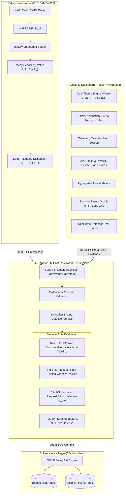
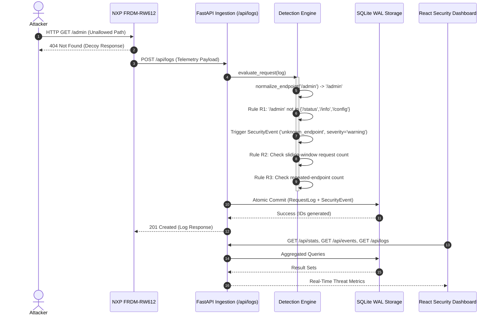

# IoT Honeypot Monitor — System Architecture

**Comprehensive Architectural Specification**  
*Covers Edge Hardware, Detection Engine, Ingestion Backend, Storage Engine, and Security Dashboard*

---

## 1. System Architecture Overview

---

## 2. Layer-by-Layer Architectural Breakdown

### 2.1 Edge Microcontroller Layer (NXP FRDM-RW612)
- **Processor**: NXP RW612 dual-core wireless MCU featuring an Arm Cortex-M33 running at 260 MHz.
- **Operating System**: FreeRTOS real-time kernel managing concurrent network tasks.
- **Network Stack**: NXP Wireless Processing Layer (WPL) interfacing with the integrated Wi-Fi radio subsystem and lwIP lightweight TCP/IP stack.
- **Decoy Server**: `httpsrv` lightweight HTTP daemon exposing legitimate-looking services:
  - `GET /status`: Device health, memory, and uptime metrics.
  - `GET /info`: Firmware version, hardware MAC, and device identifier.
  - `GET /config`: Non-sensitive network configuration parameters.
- **Telemetry Egress**: Any HTTP access (valid or probing) triggers an outgoing non-blocking HTTP POST request to the central FastAPI ingestion endpoint (`/api/logs`).

### 2.2 Ingestion & Detection Layer (FastAPI + Python 3.11+)
- **Application Framework**: FastAPI with asynchronous ASGI request processing and strict Pydantic v2 data validation schemas.
- **Security Detection Engine (`DetectionService`)**:
  - Implements thread-safe in-memory sliding window trackers (`SlidingWindowTracker`) backed by bounded double-ended queues (`deque`).
  - **Memory Safeguards**: Strict table limits (`DETECTION_MAX_TRACKING_ENTRIES = 10000`) and automatic eviction of expired window keys prevent memory denial-of-service.
  - **Normalization Subsystem**: RFC 3986 path canonicalization stripping URL fragments, query parameters, percent-encoding attacks, consecutive slashes, and trailing slashes.
  - **Alert Dampening**: Cooldown timers prevent duplicate security events from exhausting database storage during rapid automated attacks.

### 2.3 Storage Layer (SQLAlchemy 2.0 + SQLite WAL)
- **Database Engine**: SQLite configured in **Write-Ahead Logging (WAL)** mode (`PRAGMA journal_mode=WAL`) allowing concurrent read transactions alongside background log writes.
- **Transaction Handling**: Ingested request logs and all triggered security events are committed **atomically** in a single database transaction (`db.commit()`), guaranteeing complete audit consistency.
- **Migration Ready**: Pure SQLAlchemy 2.0 ORM declarations (`Base = DeclarativeBase()`), ensuring seamless migration to PostgreSQL for enterprise deployments.

### 2.4 Operations Dashboard Layer (React 19 + TypeScript)
- **Modern Build**: Vite 8 with strict TypeScript typing (`noUnusedLocals`, `strict: true`).
- **Design System**: Accessible dual-theme system:
  - **Light Mode**: Warm Cream palette (`#F7F3EB`, `#FFFCF6`, `#24231F`, `#E5DED2`).
  - **Dark Mode**: True Black palette (`#000000`, `#080808`, `#FFFFFF`, `#262626`) with zero low-contrast text and no decorative drop shadows.
- **Typography**: Inter (body & UI), Space Grotesk (headings), Instrument Serif (italic editorial accents), and JetBrains Mono (timestamps, IPs, and endpoints).
- **Resilience**: Dynamic fallback banners when backend is unreachable, automatic auto-refresh (5s interval) with prevention of duplicate background fetches.

---

## 3. Security Detection Engine Specification

### Detection Rules Table

| Rule ID | Rule Name | Trigger Criteria | Output Severity | Metadata Captured |
| :--- | :--- | :--- | :--- | :--- |
| **R1** | Unknown Endpoint | `normalized_path NOT IN allowed_endpoints_set` | `warning` | Raw endpoint, normalized endpoint, HTTP method. |
| **R2** | High Request Rate | Requests from `(device_id, source_ip)` in 10s >= 20 | `warning` | Window request count, threshold, window seconds, IP. |
| **R3** | Repeated Probes | Requests to `(device_id, source_ip, endpoint)` in 10s >= 10 | `warning` | Repeated count, threshold, endpoint, IP. |
| **R4** | Malformed Metadata | Non-standard method, invalid chars, missing fields | `422 Unprocessable` | Validation error path, rejected value, error type. |

---

## 4. Hardware Independence & Graceful Degradation

When physical hardware is disconnected or temporarily unavailable:
1. The **Backend** remains 100% operational, accepting telemetry from local test benches, edge simulators, or scripts.
2. The **Device Service** computes device activity based on verifiable timestamps. If no device has communicated within 300 seconds, status automatically reflects `inactive` or `not connected`.
3. The **Dashboard** clearly informs operators that the FRDM-RW612 board is not currently communicating, avoiding fabricated indicators or synthetic sensor readings.
