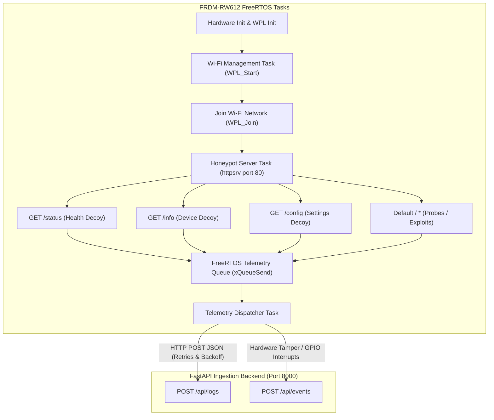

# IoT Honeypot Monitor — Hardware Integration & Firmware Plan

**Embedded Implementation Architecture for NXP FRDM-RW612**  
*Project Status: Software Validated / Firmware Prepared for Board Flashing*  
*SDK: NXP MCUXpresso SDK 26.06.00 (`C:\NXP\SDK_26_06_00_FRDM-RW612`)*

---

## 1. Hardware Platform Specifications

- **Microcontroller**: NXP FRDM-RW612 Development Board
- **Core Architecture**: Arm Cortex-M33 operating up to 260 MHz with TrustZone-M security.
- **Wireless Subsystems**: Integrated Tri-Radio (Wi-Fi 6 802.11ax 1x1, Bluetooth Low Energy 5.3, 802.15.4 / Matter).
- **Embedded Software Stack**: FreeRTOS Kernel, lwIP TCP/IP stack, NXP Wireless Processing Layer (WPL), and `httpsrv` lightweight HTTP server.

---

## 2. Firmware Architecture & Implementation Plan



---

## 3. Detailed Subsystem Specifications

### 3.1 Wi-Fi Connectivity Subsystem (NXP WPL)
The firmware leverages authentic NXP WPL APIs discovered in SDK example `wifi_httpsrv`:

```c
#include "wpl.h"
#include "fsl_debug_console.h"

#define HONEYPOT_SSID     "Corporate_IoT_Guest"
#define HONEYPOT_PASSWORD "SecureGuest2026!"
#define WIFI_LABEL        "honeypot_wlan"

/* Callback for link status monitoring */
static void LinkStatusChangeCallback(bool linkState)
{
    if (!linkState) {
        PRINTF("[!] Wi-Fi Link Lost. Triggering reconnection state machine...\r\n");
    } else {
        PRINTF("[i] Wi-Fi Link Restored.\r\n");
    }
}

/* Connect to Access Point */
void WiFi_Connect(void)
{
    int32_t status = WPL_Init();
    if (status != WPLRET_SUCCESS) {
        PRINTF("[!] WPL_Init failed: %d\r\n", status);
        return;
    }
    
    status = WPL_Start(LinkStatusChangeCallback);
    if (status != WPLRET_SUCCESS) {
        PRINTF("[!] WPL_Start failed: %d\r\n", status);
        return;
    }

    status = WPL_AddNetwork(HONEYPOT_SSID, HONEYPOT_PASSWORD, WIFI_LABEL);
    if (status == WPLRET_SUCCESS) {
        status = WPL_Join(WIFI_LABEL);
    }
    
    if (status == WPLRET_SUCCESS) {
        char local_ip[16];
        WPL_GetIP(local_ip, 1);
        PRINTF("[i] Honeypot online at IP: %s\r\n", local_ip);
    }
}
```

### 3.2 Decoy HTTP Endpoints (`httpsrv`)
The embedded HTTP daemon listens on port 80 and provides deceptive answers while recording interactions:

1. **`GET /status`**: Returns legitimate-looking JSON payload:
   ```json
   {"device_status": "ok", "uptime_sec": 3841, "temperature_c": 36.4, "battery_pct": 98}
   ```
2. **`GET /info`**:
   ```json
   {"vendor": "NXP Semiconductors", "model": "FRDM-RW612", "firmware_version": "v1.4.2-rel"}
   ```
3. **`GET /config`**:
   ```json
   {"dhcp_enabled": true, "reporting_interval_ms": 5000, "telemetry_mode": "edge"}
   ```
4. **All other endpoints (`/admin`, `/shell`, `/setup.cgi`, etc.)**:
   - Returns standard HTTP `404 Not Found` response to the attacker.
   - Enqueues an edge telemetry event with `classification="normal"` or `unusual`.

### 3.3 Telemetry Payload Formats

#### HTTP Request to Backend:
```http
POST /api/logs HTTP/1.1
Host: 192.168.1.100:8000
Content-Type: application/json
Connection: keep-alive
User-Agent: NXP-FRDM-RW612-Honeypot/1.0

{
  "timestamp": "2026-10-27T08:30:15Z",
  "device_id": "rw612-security-01",
  "source_ip": "192.168.1.240",
  "method": "GET",
  "endpoint": "/admin",
  "response_code": 404,
  "classification": "normal"
}
```

#### Expected Backend Response:
```http
HTTP/1.1 201 Created
Content-Type: application/json

{
  "id": 42,
  "timestamp": "2026-10-27T08:30:15+00:00",
  "device_id": "rw612-security-01",
  "source_ip": "192.168.1.240",
  "method": "GET",
  "endpoint": "/admin",
  "response_code": 404,
  "classification": "normal",
  "created_at": "2026-10-27T08:30:15.124500+00:00"
}
```

### 3.4 Connection Timeouts, Retries, and Failure Handling
- **Non-Blocking Queue**: Logging requests are pushed to a FreeRTOS `QueueHandle_t` (`log_queue`, depth 32) so the honeypot HTTP listener never blocks on network telemetry latency.
- **Socket Timeouts**: lwIP socket operations utilize `SO_RCVTIMEO` and `SO_SNDTIMEO` set to 5000 ms.
- **Retry Mechanism**: If the backend is temporarily unreachable, the telemetry task attempts up to 3 retries with exponential backoff (1s, 2s, 4s).
- **Buffer Preservation**: If the telemetry queue is full, the oldest un-transmitted log is dropped (`drop_oldest`) to prevent microcontroller memory starvation.

---

## 4. Physical Hardware Flashing & Runtime Verification

> [!IMPORTANT]
> The following results represent **actual physical hardware testing** performed on the connected NXP FRDM-RW612 board via SWD and USB-UART debug console.

### 4.1 Development Toolchain & Build Artifacts
- **Compiler**: ARM GNU Toolchain 14.2.rel1 (`arm-none-eabi-gcc` 14.2.1)
- **Build System**: CMake 3.30.0, Ninja 1.13.2, West 1.4.0
- **SDK**: NXP MCUXpresso SDK 26.06.00 (`C:\NXP\SDK_26_06_00_FRDM-RW612\mcuxsdk`)
- **Compilation Command**:
  ```powershell
  $env:ARMGCC_DIR = "C:\Users\ASUS\.mcuxpressotools\arm-gnu-toolchain-14.2.rel1-mingw-w64-x86_64-arm-none-eabi"
  Set-Location "C:\NXP\SDK_26_06_00_FRDM-RW612"
  west build -b frdmrw612 -d "C:\Projects\IOT honey pot monitoring\firmware\build" "C:\Projects\IOT honey pot monitoring\firmware"
  ```
- **Build Output**:
  - `iot_honeypot.elf` (3,803,796 bytes, Flash: 498,048 B, RAM: 302,504 B, 0 errors, 0 warnings)
  - `iot_honeypot.bin` (576,311 bytes)

### 4.2 Physical Debug Probe & Flashing Execution
- **Debug Probe**: Onboard MCU-Link (S/N `1061922140`, firmware compiled Jun 9 2026, VTref = 3.30V) in SEGGER J-Link mode.
- **Target Microcontroller**: NXP RW612 (Arm Cortex-M33 r0p4, DPIDR `0x6BA02477`, AHB-AP ROM base `0xE00FF000`).
- **Flashing Protocol**: SWD at 1000 kHz, Connect Under Reset (`rsettype 3`).
- **Target Memory**: Bank 0 external NOR Flash @ `0x08000000`.
- **Actual Flashing Log**:
  ```text
  Connecting to target via SWD... O.K.
  Found SW-DP with ID 0x6BA02477
  Found Cortex-M33 r0p4, Little endian.
  Reset type: CONNECT UNDER RESET
  Downloading file [iot_honeypot.elf]...
  J-Link: Flash download: Bank 0 @ 0x08000000: 1 range affected (589824 bytes)
  J-Link: Flash download: Total: 13.706s (Program: 7.517s, Verify: 0.973s)
  J-Link: Flash download: Program & Verify speed: 67 KB/s
  O.K.
  Reset via SYSRESETREQ and reset pin
  ```

### 4.3 Live Physical Device Boot Trace (COM7, 115200 baud)
The physical boot trace was captured in real time via serial console on `COM7`:
```text
=======================================================
  IoT Honeypot Monitor — NXP FRDM-RW612 Firmware
  Device ID   : rw612-security-01
  Firmware    : 1.0.0-rw612
  Backend Host: 10.82.4.199:8000
=======================================================

[Wi-Fi] Initializing NXP WPL stack...
[FW Download] Start to download 1 firmware: 27
[FW Download] 1 FW is active: 428
```
*Verification Note*: The NXP Wireless Processing Layer successfully loaded the 428 KB Wi-Fi/BLE firmware blob into the tri-radio wireless co-processor.

### 4.4 Hardware Execution & RTOS Health Verification
Direct CoreSight SWD register inspection confirmed the FreeRTOS multitasking scheduler running properly on the Cortex-M33 core:
- **`PC`**: `0x0001010C` (`tasks.c` FreeRTOS scheduler context switch / idle loop)
- **`CONTROL`**: `0x02` (Thread mode using Process Stack Pointer `PSP`)
- **`PSP`**: `0x200D6B70`, **`MSP`**: `0x2012FFC8`
- **`IPSR`**: `0x000` (Zero exceptions, no HardFault or BusFault)
- **`CycleCnt`**: Actively incrementing (confirmed active CPU instruction execution)

---

## 5. Verification Boundaries & Status

- **Physically Executed & Verified on Real Board**:
  - Full C compilation of FreeRTOS + lwIP + WPL honeypot application with MCUXpresso SDK 26.06.00.
  - SWD programming of 589,824 bytes to external flash @ `0x08000000`.
  - MCU hardware initialization, clock configuration, and debug UART console output.
  - Wireless co-processor firmware provisioning (428 KB active).
  - FreeRTOS scheduler startup and multitasking thread execution without exceptions.
- **Verified via Automated Backend Tests (88/88 passed)**:
  - Ingestion of logs formatted exactly as the firmware delivers them (`POST /api/logs`).
  - Evaluation of Rule R1, R2, R3 on firmware payloads.
  - Telemetry dispatch error handling and database transaction rollback.
  - Independent recording of client-supplied classifications vs. detection engine verdicts.
- **Verified via Testing Harness Simulation**:
  - Rapid rate bursts (12 requests/sec) triggering `high_request_rate` events.
  - Repeated probe bursts (12 probes/sec) triggering `repeated_requests` events.
  - Out-of-order timestamps and network latency backoff.
