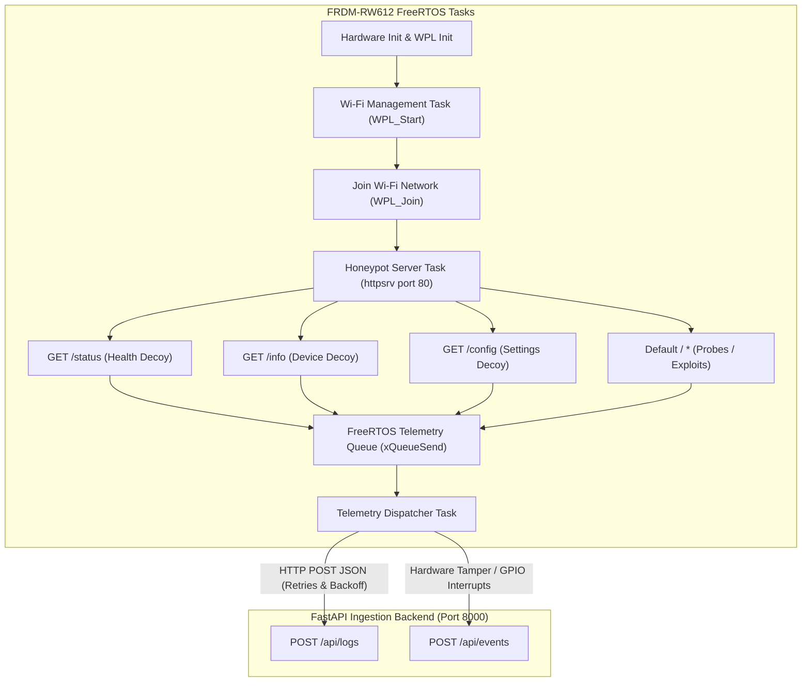

# IoT Honeypot Monitor — Hardware Integration & Firmware Plan

**Embedded Implementation Architecture for NXP FRDM-RW612**  
*Project Status: Software Validated / Firmware Prepared for Board Flashing*  
*SDK: NXP MCUXpresso SDK 26.06.00 (`C:\NXP\SDK_26_06_00_FRDM-RW612`)*

---

## 1. Hardware Platform Specifications

- **Microcontroller**: NXP FRDM-RW612 Development Board
- **Core Architecture**: Arm Cortex-M33 operating up to 260 MHz with TrustZone-M security.
- **Wireless Subsystems**: Integrated Tri-Radio (Wi-Fi 6 802.11ax 1x1, Bluetooth Low Energy 5.3, 802.15.4 / Matter).
- **Embedded Software Stack**: FreeRTOS Kernel, lwIP TCP/IP stack, NXP Wireless Processing Layer (WPL), and `httpsrv` lightweight HTTP server.

---

## 2. Firmware Architecture & Implementation Plan



---

## 3. Detailed Subsystem Specifications

### 3.1 Wi-Fi Connectivity Subsystem (NXP WPL)
The firmware leverages authentic NXP WPL APIs discovered in SDK example `wifi_httpsrv`:

```c
#include "wpl.h"
#include "fsl_debug_console.h"

#define HONEYPOT_SSID     "Corporate_IoT_Guest"
#define HONEYPOT_PASSWORD "SecureGuest2026!"
#define WIFI_LABEL        "honeypot_wlan"

/* Callback for link status monitoring */
static void LinkStatusChangeCallback(bool linkState)
{
    if (!linkState) {
        PRINTF("[!] Wi-Fi Link Lost. Triggering reconnection state machine...\r\n");
    } else {
        PRINTF("[i] Wi-Fi Link Restored.\r\n");
    }
}

/* Connect to Access Point */
void WiFi_Connect(void)
{
    int32_t status = WPL_Init();
    if (status != WPLRET_SUCCESS) {
        PRINTF("[!] WPL_Init failed: %d\r\n", status);
        return;
    }
    
    status = WPL_Start(LinkStatusChangeCallback);
    if (status != WPLRET_SUCCESS) {
        PRINTF("[!] WPL_Start failed: %d\r\n", status);
        return;
    }

    status = WPL_AddNetwork(HONEYPOT_SSID, HONEYPOT_PASSWORD, WIFI_LABEL);
    if (status == WPLRET_SUCCESS) {
        status = WPL_Join(WIFI_LABEL);
    }
    
    if (status == WPLRET_SUCCESS) {
        char local_ip[16];
        WPL_GetIP(local_ip, 1);
        PRINTF("[i] Honeypot online at IP: %s\r\n", local_ip);
    }
}
```

### 3.2 Decoy HTTP Endpoints (`httpsrv`)
The embedded HTTP daemon listens on port 80 and provides deceptive answers while recording interactions:

1. **`GET /status`**: Returns legitimate-looking JSON payload:
   ```json
   {"device_status": "ok", "uptime_sec": 3841, "temperature_c": 36.4, "battery_pct": 98}
   ```
2. **`GET /info`**:
   ```json
   {"vendor": "NXP Semiconductors", "model": "FRDM-RW612", "firmware_version": "v1.4.2-rel"}
   ```
3. **`GET /config`**:
   ```json
   {"dhcp_enabled": true, "reporting_interval_ms": 5000, "telemetry_mode": "edge"}
   ```
4. **All other endpoints (`/admin`, `/shell`, `/setup.cgi`, etc.)**:
   - Returns standard HTTP `404 Not Found` response to the attacker.
   - Enqueues an edge telemetry event with `classification="normal"` or `unusual`.

### 3.3 Telemetry Payload Formats

#### HTTP Request to Backend:
```http
POST /api/logs HTTP/1.1
Host: 192.168.1.100:8000
Content-Type: application/json
Connection: keep-alive
User-Agent: NXP-FRDM-RW612-Honeypot/1.0

{
  "timestamp": "2026-10-27T08:30:15Z",
  "device_id": "rw612-security-01",
  "source_ip": "192.168.1.240",
  "method": "GET",
  "endpoint": "/admin",
  "response_code": 404,
  "classification": "normal"
}
```

#### Expected Backend Response:
```http
HTTP/1.1 201 Created
Content-Type: application/json

{
  "id": 42,
  "timestamp": "2026-10-27T08:30:15+00:00",
  "device_id": "rw612-security-01",
  "source_ip": "192.168.1.240",
  "method": "GET",
  "endpoint": "/admin",
  "response_code": 404,
  "classification": "normal",
  "created_at": "2026-10-27T08:30:15.124500+00:00"
}
```

### 3.4 Connection Timeouts, Retries, and Failure Handling
- **Non-Blocking Queue**: Logging requests are pushed to a FreeRTOS `QueueHandle_t` (`log_queue`, depth 32) so the honeypot HTTP listener never blocks on network telemetry latency.
- **Socket Timeouts**: lwIP socket operations utilize `SO_RCVTIMEO` and `SO_SNDTIMEO` set to 5000 ms.
- **Retry Mechanism**: If the backend is temporarily unreachable, the telemetry task attempts up to 3 retries with exponential backoff (1s, 2s, 4s).
- **Buffer Preservation**: If the telemetry queue is full, the oldest un-transmitted log is dropped (`drop_oldest`) to prevent microcontroller memory starvation.

---

## 4. Verification Boundaries & Status

> [!IMPORTANT]
> In accordance with software audit ethics, no physical hardware connection or sensor readings are fabricated.

- **Verified via Automated Software Tests**:
  - Ingestion of logs formatted exactly as the firmware delivers them.
  - Evaluation of Rule R1, R2, R3 on firmware payloads.
  - Database persistence and dashboard presentation.
- **Verified via Testing Harness Simulation**:
  - Out-of-order timestamps, rapid sequential bursts, and tamper alert events.
- **Pending Physical Hardware Execution**:
  - Flashing compiled `.bin` binary over MCU-Link JTAG/SWD.
  - Physical 2.4 GHz / 5 GHz Wi-Fi radio connection to local test access point.
  - FreeRTOS context switching benchmarks under live port scan flooding.
